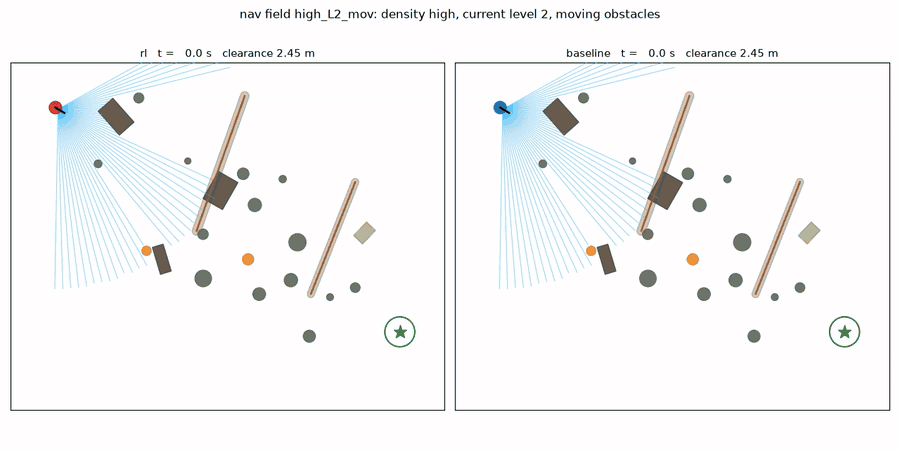
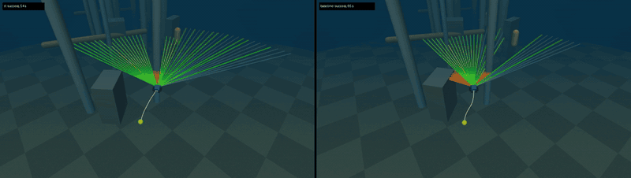

# rov-rl-mujoco

Reinforcement learning for an underwater ROV in MuJoCo, compared head to head with classical controllers. The
vehicle is a BlueROV2-Heavy-like model in MuJoCo's fluid model, trained with MJX + Brax PPO on one RTX 5080.

**Sonar-only obstacle avoidance: RL (left) vs the VFH+ planner (right)**, same field, same moving obstacles:

[](docs/media/nav2/nav2_overhead_rl_vs_vfh.mp4)

*Overhead map, 4x real time. The blue fan is the sonar, the controller's only obstacle sensing. Orange discs are moving
obstacles, and the field has a 0.2 m/s current. RL threads straight through the field and reaches the goal in 54 s with
a path 1.14 times the straight line; VFH+ detours around the field and takes 65 s with a path 1.30 times the straight
line. Clearance is live in each panel title.
[mp4](docs/media/nav2/nav2_overhead_rl_vs_vfh.mp4)*

| Station keeping & tracking: PID (left) vs RL (right) | Same navigation run from the chase camera |
|---|---|
| [](docs/media/rov_pid_vs_rl_combined.mp4) | [](docs/media/nav2/nav2_high_L2_mov_rl_vs_vfh.mp4) |
| 0.2 m/s current, plant randomisation, thruster failure ([mp4](docs/media/rov_pid_vs_rl_combined.mp4)) | dense field, current, moving obstacles ([mp4](docs/media/nav2/nav2_high_L2_mov_rl_vs_vfh.mp4)) |

## Results

**Control** (20 episodes per cell, same seeds for PID and RL):

| scenario | PID | RL |
|---|---|---|
| station keeping, calm water | **0.001 m** RMS | 0.007 m |
| tracking, 0.4 m/s current (beyond training range) | 0.131 m, 90 % success | **0.048 m, 100 %** |
| tracking, thruster failure | 0.039 m, 95 % | **0.030 m, 100 %** |
| tracking, all disturbances combined | 0.058 m, 90 % | **0.041 m, 100 %** |

**Sonar navigation** (no map; 18 cells x 20 episodes, same seeds for every controller):

| | VFH+ planner | RL v1 | **RL v2** (memory + safety shaping + curriculum) |
|---|---|---|---|
| success | 99 % | 78 % | **97 %** |
| collisions | 0 % | 22 % | **3 %** |
| time to goal | 50.7 s | 44.0 s | **41.8 s** |
| path / straight line | 1.27 | 1.05 | **1.06** |
| thrust impulse | 6539 N s | 5617 N s | **5134 N s** |

RL wins on speed, path and energy. The planner still wins on safety, and a safety shield to close that gap is in
progress. The RL v1 column is from the static-only nav evaluation (9 cells).

## Quick start

```bash
pip install mujoco numpy pytest                      # CPU: tests, PID baseline, VFH+ baseline
PYTEST_DISABLE_PLUGIN_AUTOLOAD=1 python -m pytest -q
MJRL_VENV=~/.venvs/mjrl scripts/run_ws1.sh full      # GPU: train + evaluate + videos (control task)
MJRL_VENV=~/.venvs/mjrl scripts/run_ws1.sh nav2_full # GPU: sonar navigation v2
```

## More

- [docs/CONTROL.md](docs/CONTROL.md): the vehicle and hydrodynamics model (parameters from published BlueROV2 data),
  tasks, the PID baseline, metrics, the full results table, verification, limitations.
- [docs/NAV.md](docs/NAV.md): sonar navigation. Covers the scene, sensing, rewards, the VFH+ baseline, the nav and
  nav2 designs (fan memory, moving obstacles, curriculum), full per-cell tables and path plots.

Known simplifications: no added mass; inertia-box fluid drag (MJX does not implement the ellipsoid model); simulation only.
