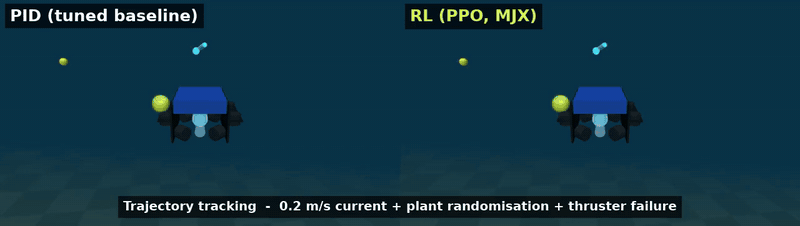

# rov-rl-mujoco

An RL controller (MJX + Brax PPO with domain randomization) for a BlueROV2-Heavy-like
underwater vehicle in MuJoCo, compared against a tuned cascade-PID baseline on the same
episodes. The repo covers station keeping in currents, 3D waypoint tracking with heading,
and robustness to plant changes and thruster failure. Videos come from a chase camera
with a murky-water look.

[](docs/media/rov_pid_vs_rl_combined.mp4)

*Left: tuned PID. Right: RL. Trajectory tracking in a 0.2 m/s current, with plant randomisation and a thruster failure
([mp4](docs/media/rov_pid_vs_rl_combined.mp4)).*

**Headline (20 episodes per cell, CPU MuJoCo evaluation):** in calm water the tuned PID is more precise
(station keeping 0.001 m vs 0.007 m RMS). As disturbances grow, the RL policy matches it and then beats it:
- 0.4 m/s current, tracking (outside the 0.35 m/s training range): RL **0.048 m** RMS, 100 % success; PID 0.131 m, 90 %.
- All disturbances combined, tracking: RL **0.041 m**, 100 %; PID 0.058 m, 90 %, with 10 % of episodes terminated.

## Layout

| Path | Content |
|---|---|
| `rov_rl/assets/bluerov2_heavy.xml` | MJCF: primitive geoms, 8 site thrusters with lag, fluid model, chase camera, fog |
| `rov_rl/vehicle.py` | published parameters (FLU frame), allocation matrix read from the compiled model |
| `rov_rl/core.py` | backend-agnostic (NumPy / jax.numpy) reference, current, buoyancy, observation, reward, randomization |
| `rov_rl/mjx_env.py` | MuJoCo Playground `MjxEnv` for Brax PPO |
| `rov_rl/cpu_env.py` | NumPy / CPU-MuJoCo mirror of the MJX env (tests, PID, evaluation, video) |
| `rov_rl/pid_baseline.py` | cascade PID + pseudo-inverse allocation; gains in `config/pid_gains.json` |
| `rov_rl/rollout.py`, `rov_rl/render.py` | episode runner, metrics, offscreen rendering |
| `train.py`, `eval.py` | PPO training, RL vs PID evaluation (metrics JSON, markdown table, MP4) |
| `scripts/run_ws1.sh` | GPU workstation pipeline: env report, tests, smoke run, full run |
| `scripts/tune_pid.py` | PID gain tuning (CPU) |
| `scripts/derive_hydro_params.py` | derives the MJCF inertia / viscosity values from the published damping |
| `tests/` | fluid sanity, allocation, reward, core logic, CPU env + PID regression, MJX-vs-CPU parity |
| `rov_rl/nav_core.py` | nav task (see [Navigation](#local-planning--obstacle-avoidance-with-sonar-nav-task)): obstacle fields, analytic sonar, clearance, reward, shared velocity controller |
| `rov_rl/nav_cpu_env.py`, `rov_rl/nav_mjx_env.py` | nav CPU env (+ scene model for rendering / ray checks) and MJX env |
| `rov_rl/nav_baseline.py` | VFH+ planner over a sonar-built occupancy grid; parameters in `config/nav_baseline.json` |
| `rov_rl/nav_rollout.py`, `rov_rl/nav_render.py` | nav episode runner and metrics, sonar-fan videos, overhead path plot |
| `eval_nav.py`, `scripts/tune_nav_baseline.py` | nav evaluation (RL vs VFH+), baseline tuning (CPU) |

## Vehicle model

All parameters come from **[vB22]**: M. von Benzon et al., "An Open-Source Benchmark
Simulator: Control of a BlueROV2 Underwater Robot", *J. Mar. Sci. Eng.* 10(12):1898, 2022,
doi:10.3390/jmse10121898 (Table A1, Table 4, Table 5, Eqs. 18-19). They are converted from
NED body axes to MuJoCo's FLU body / z-up world. No CAD is used. The geometry is built
from primitive geoms inside the published 0.46 x 0.58 x 0.38 m envelope.

| Quantity | [vB22] | This model |
|---|---|---|
| mass | 13.5 kg | 13.5 kg (hull 13.25 + hydro proxy 0.25) |
| inertia Ixx, Iyy, Izz | 0.26, 0.23, 0.37 kg m^2 | same (hull + proxy) |
| CoB rel. CoG | 0.01 m above | 0.01 m above (randomized 0.005-0.02 m in training) |
| buoyancy | V = 0.0134 m^3, so B/W = 0.993 | **B/W = 1.01** (trimmed slightly positive, +1.3 N); randomized 0.98-1.04 |
| thrusters | 8 x T200, Heavy vectored layout | same positions and axes (site-based actuators) |
| thrust limit | F(V=+-1) = +-30.4 N (Eq. 18) | ctrlrange +-30.4 N |
| thruster dynamics | 3rd-order TF (Eq. 19) | first-order filter, tau = 0.0287 s (mean-delay matched: a1/a0 - b1/b0) |
| max axis force | 85 N surge/sway, 120 N heave (Table 4) | 85 / 85 / 121.6 N (checked in a test) |
| quadratic damping X/Y/Z | 141 / 217 / 190 N s^2/m^2 | **141 / 217 / 190** (measured in a test) |
| linear damping X/Y/Z | 13.7 / 0 / 33 N s/m | 13.7 / 13.7 / 13.7 (isotropic in MuJoCo) |
| quadratic rot. damping K/M/N | 1.19 / 0.47 / 1.5 | 1.25 / 1.52 / 1.71 |
| linear rot. damping K/M/N | 0 / 0.8 / 0 | 0.92 / 0.92 / 0.92 |
| added mass | 6.36 / 7.12 / 18.68 kg, ... | **not modelled** (see limitations) |

**Discrepancy in [vB22].** Table A1 gives the horizontal thruster orientation angles as
beta = {0, pi/2, 3pi/4, pi}. With beta3 = 3pi/4, thruster 3 becomes a pure-sway thruster,
which contradicts the symmetric vectored layout in their Fig. 3. This model uses 3pi/2,
which gives the standard 45-degree "X" layout.

### Hydrodynamics: MuJoCo built-in fluid model, verified against source

* **MJX supports only the inertia-box variant.** mujoco-mjx 3.17.0,
  `_src/passive.py::_fluid` and `_inertia_box_fluid_model`, uses only per-body inertia
  boxes. It **silently ignores** per-geom `fluidshape="ellipsoid"` / `fluidcoef`. Using
  the ellipsoid model would make the CPU evaluation physics differ from the MJX training
  physics. The MJCF therefore sets no `fluidshape`, and `tests/test_fluid.py` asserts this.
  MJX also rejects `implicitfast` when fluid forces are on, so the integrator is Euler.
* `option density="1000"` (water). `viscosity` is an **effective eddy viscosity**
  (1.707 Pa s). It is fitted so that the Stokes term reproduces the identified linear surge
  damping X_u = 13.7 N s/m. It is not water's molecular viscosity (~0.001 Pa s), whose term
  is about 1e-3 of the identified value.
* **Per-axis quadratic drag.** A body's inertia-box drag is fixed by its mass and inertia,
  and the CAD inertia alone gives about 49 / 45 / 82 N s^2/m^2. To reach the identified
  141 / 217 / 190 values, a light (0.25 kg) welded child body, `hydro_proxy`, has an inertia
  box sized so that the hull and proxy drag add up to exactly those values. Its inertia is
  subtracted from the hull, so the total rigid-body inertia still equals the CAD values.
  `fusestatic="false"` keeps MuJoCo from merging the two bodies.
  `scripts/derive_hydro_params.py` derives the numbers, and a test checks them on the
  compiled model.
* **Current = `option/wind`.** MuJoCo subtracts `wind` from body velocity inside the fluid
  model. The MJX source does the same (`lwind = ximat.T @ m.opt.wind`). A test shows that a
  still body in current w feels the same force as a body moving at -w in still water. The
  current is world-frame: constant plus a per-axis sinusoid, updated every control step.
* **Buoyancy is not part of MuJoCo's fluid model.** A test shows zero fluid force at zero
  relative velocity. Buoyancy is applied as an **explicit force**: `xfrc_applied` on body
  `rov`, a world +z force of magnitude B/W x m g at the centre of buoyancy (force at the
  CoG plus the moment r_cob x F). The CPU and MJX envs recompute it every physics substep
  from the current orientation. This gives the righting moment.

## Tasks, randomization, interface

* **Timing:** physics 4 ms, control 40 ms (25 Hz), episodes 40 s (1000 steps).
* **Station keeping:** hold the origin at yaw 0. The vehicle starts up to 1 m and 0.8 rad
  away.
* **Tracking:** constant-speed (0.2-0.4 m/s) path through 4 waypoints (3 random 3D segments
  of 1.5-3 m), with independent waypoint headings interpolated along each segment, then a
  hold at the last waypoint.
* **Training randomization** (`config.TRAIN_RANDOMIZATION`, re-sampled every episode
  because the training wrapper uses `full_reset=True`):
  * current: 0-0.35 m/s constant plus a 0-0.12 m/s sinusoid at 0.02-0.2 Hz
  * mass and inertia: x0.85-1.15
  * B/W: 0.98-1.04; CoB height: 0.005-0.02 m
  * drag (density and viscosity): x0.7-1.4
  * thruster gain: 0.85-1
  * thruster tau: 0.02-0.08 s
  * 15 % of episodes: one random thruster dies at a random time in the first half
* **Observation (29, body frame, no privileged information):**
  * position error (clipped to +-2 m), linear velocity, reference velocity, angular velocity
  * gravity direction
  * sin/cos of the yaw error, reference yaw rate
  * leaky integral of the position error (tau 10 s, so a memoryless policy can reject
    constant currents)
  * previous action
* **Action:** 8 normalized thruster commands in [-1, 1], scaled to +-30.4 N, then passed
  through the actuator lag.
* **Reward:** two Gaussian position terms (0.5 m and 0.1 m scales) plus a yaw term, minus
  penalties for effort, action change and tilt. An episode terminates with -10 when the
  position error exceeds 4 m, tilt exceeds 60 degrees, or the state becomes non-finite.
  Weights are in `config.RewardConfig`.
* **PPO** (`train.py`):
  * policy MLP 4x128, value MLP 5x256, tanh-Normal actions
  * 2048 envs, unroll 30, batch 1024 x 32 minibatches, 8 updates per batch
  * gamma 0.99, learning rate 3e-4, entropy 5e-3
  * 150 M steps (full preset)

### PID baseline

* **Structure:** world-frame position PI produces a saturated velocity command (with
  reference feed-forward). A body-frame velocity P loop adds nominal-drag feed-forward. Yaw
  uses P plus reference yaw-rate feed-forward, feeding a yaw-rate P loop. Roll and pitch use
  PD to level. Nominal net buoyancy is fed forward. The resulting wrench goes through the
  pseudo-inverse of the 6x8 allocation matrix, scaled uniformly when a thruster saturates.
  Anti-windup uses conditional integration.
* **Information:** like the policy, the PID gets no current, plant or failure information.
* **Tuning:** gains were tuned by `scripts/tune_pid.py`, a multiplicative coordinate search
  on CPU. The objective is position RMS + 0.3 x yaw RMS + 2e-5 x thrust impulse, over
  station-keeping and tracking episodes at disturbance levels 1 and 3. Each level is run
  with the nominal plant, with the training plant randomization, and with a single
  thruster failure. An earlier tuning run without failure episodes lowered the attitude
  gains until the vehicle rolled over (tilt > 60 degrees) after a vertical thruster died, so
  failures are now part of the objective. The tuning seed differs from the evaluation seed. The result and its provenance note are in
  `config/pid_gains.json`.

### Metrics (`rov_rl/rollout.py`)

* **Error window:** for station keeping, errors are computed over t >= 10 s; for tracking,
  over the whole episode.
* **pos RMS / pos max [m]:** norm of the 3D position error inside the window.
* **settling time [s]:** the time after which the position error stays below 0.1 m and the
  yaw error below 5 degrees until the episode ends. It is NaN if the episode never settles.
  For tracking it marks the final convergence, not the initial one.
* **thrust impulse [N s]:** the sum over thrusters of |F| dt. This is the "energy" proxy;
  electrical energy is not modelled.
* **success:** the episode completes without termination, and:
  * station keeping: max error in the window <= 0.2 m;
  * tracking: RMS <= 0.3 m and final error <= 0.3 m.
* **Reporting:** error metrics are averaged over completed episodes only. The success,
  termination and settled rates use all episodes.
* **Evaluation cells:**
  * both tasks at disturbance levels 0-4:
    (0, 0), (0.1, 0.03), (0.2, 0.06), (0.3, 0.09), (0.4, 0.12) m/s for (constant,
    amplitude). Level 4 is above the training range.
  * robustness scenarios at level 2:
    * `params`: mass, buoyancy, drag, gain and lag randomized
    * `thruster_failure`: one random thruster dies at t = 10 s
    * `combined`: both of the above
* **Paired comparison:** RL and PID run the identical sampled episodes. RL is evaluated in
  CPU MuJoCo, so the evaluation is also a sim-to-sim check against the MJX training physics.

## Running

Laptop / CPU (no JAX needed): unit tests and PID-only evaluation.

```bash
pip install mujoco numpy pytest          # + imageio imageio-ffmpeg for videos
PYTEST_DISABLE_PLUGIN_AUTOLOAD=1 python -m pytest -q      # MJX parity test is skipped without JAX
python scripts/derive_hydro_params.py    # prints the MJCF inertia / viscosity values
python eval.py --controllers pid --episodes 5 --out-dir outputs/pid_only --no-video
python scripts/tune_pid.py --out config/pid_gains.json   # re-tune (several minutes)
```

GPU workstation (venv with `jax[cuda12] mujoco mujoco-mjx playground brax imageio
imageio-ffmpeg pytest`):

```bash
MJRL_VENV=~/.venvs/mjrl scripts/run_ws1.sh smoke   # env report, all tests incl. MJX parity, short train + eval
MJRL_VENV=~/.venvs/mjrl scripts/run_ws1.sh full    # 150 M step training + full evaluation + videos
tail -f runs/full/train.log                        # progress line per PPO evaluation
tail -f runs/full/eval.log                         # one line per episode, tally every 10
```

Outputs:
* `runs/<stage>/policy/{params.pkl,policy_config.json}`: overwritten at every PPO
  evaluation, so a partial run still leaves a usable policy.
* `runs/<stage>/progress.jsonl`
* `runs/<stage>/eval/{metrics.json,results.md,videos/*.mp4}`

## Results

Measured on workstation1 (RTX 5080), 2026-11-06, with `scripts/run_ws1.sh full`:
- **Code:** repo state `abab31a`. The run config records the revision as "unknown" because the tree was synced without `.git`.
- **Training:** PPO with domain randomisation, 165 M env steps in 411 s, including a 27 s JIT compile.
- **Evaluation:** CPU MuJoCo (float64), 20 episodes per cell, run on the same seeds and episodes for PID and RL.
- **Levels:** level 4 (0.4 m/s) is deliberately outside the training range.

| task | scenario | level (current const/amp m/s) | controller | pos RMS [m] | pos max [m] | settling [s] | thrust impulse [N s] | success | terminated |
|---|---|---|---|---|---|---|---|---|---|
| station | nominal | 0 (0.00/0.00) | pid | 0.001 | 0.003 | 1.3 | 199 | 1.00 | 0.00 |
| station | nominal | 0 (0.00/0.00) | rl | 0.007 | 0.015 | 1.3 | 404 | 1.00 | 0.00 |
| station | nominal | 1 (0.10/0.03) | pid | 0.003 | 0.005 | 1.4 | 391 | 1.00 | 0.00 |
| station | nominal | 1 (0.10/0.03) | rl | 0.009 | 0.018 | 1.5 | 481 | 1.00 | 0.00 |
| station | nominal | 2 (0.20/0.06) | pid | 0.009 | 0.014 | 1.4 | 846 | 1.00 | 0.00 |
| station | nominal | 2 (0.20/0.06) | rl | 0.009 | 0.016 | 1.4 | 860 | 1.00 | 0.00 |
| station | nominal | 3 (0.30/0.09) | pid | 0.016 | 0.024 | 1.6 | 1545 | 1.00 | 0.00 |
| station | nominal | 3 (0.30/0.09) | rl | 0.013 | 0.024 | 1.6 | 1541 | 1.00 | 0.00 |
| station | nominal | 4 (0.40/0.12) | pid | 0.025 | 0.038 | 2.2 | 2536 | 1.00 | 0.00 |
| station | nominal | 4 (0.40/0.12) | rl | 0.020 | 0.038 | 2.3 | 2472 | 1.00 | 0.00 |
| track | nominal | 0 (0.00/0.00) | pid | 0.024 | 0.281 | 0.4 | 797 | 1.00 | 0.00 |
| track | nominal | 0 (0.00/0.00) | rl | 0.026 | 0.282 | 0.4 | 824 | 1.00 | 0.00 |
| track | nominal | 1 (0.10/0.03) | pid | 0.025 | 0.271 | 0.5 | 924 | 1.00 | 0.00 |
| track | nominal | 1 (0.10/0.03) | rl | 0.026 | 0.272 | 1.5 | 908 | 1.00 | 0.00 |
| track | nominal | 2 (0.20/0.06) | pid | 0.031 | 0.306 | 1.3 | 1259 | 1.00 | 0.00 |
| track | nominal | 2 (0.20/0.06) | rl | 0.029 | 0.306 | 1.0 | 1208 | 1.00 | 0.00 |
| track | nominal | 3 (0.30/0.09) | pid | 0.044 | 0.310 | 3.3 | 1795 | 1.00 | 0.00 |
| track | nominal | 3 (0.30/0.09) | rl | 0.033 | 0.295 | 2.1 | 1724 | 1.00 | 0.00 |
| track | nominal | 4 (0.40/0.12) | pid | 0.131 | 0.485 | 15.1 | 2746 | 0.90 | 0.00 |
| track | nominal | 4 (0.40/0.12) | rl | 0.048 | 0.295 | 9.3 | 2543 | 1.00 | 0.00 |
| station | params | 2 (0.20/0.06) | pid | 0.010 | 0.016 | 1.5 | 937 | 1.00 | 0.00 |
| station | params | 2 (0.20/0.06) | rl | 0.011 | 0.020 | 1.6 | 925 | 1.00 | 0.00 |
| station | thruster_failure | 2 (0.20/0.06) | pid | 0.015 | 0.028 | 1.4 | 867 | 1.00 | 0.00 |
| station | thruster_failure | 2 (0.20/0.06) | rl | 0.013 | 0.021 | 1.4 | 891 | 1.00 | 0.00 |
| station | combined | 2 (0.20/0.06) | pid | 0.018 | 0.035 | 2.3 | 926 | 1.00 | 0.00 |
| station | combined | 2 (0.20/0.06) | rl | 0.013 | 0.024 | 3.7 | 944 | 1.00 | 0.00 |
| track | params | 2 (0.20/0.06) | pid | 0.033 | 0.299 | 2.2 | 1475 | 1.00 | 0.00 |
| track | params | 2 (0.20/0.06) | rl | 0.030 | 0.297 | 1.0 | 1388 | 1.00 | 0.00 |
| track | thruster_failure | 2 (0.20/0.06) | pid | 0.039 | 0.295 | 10.8 | 1287 | 0.95 | 0.05 |
| track | thruster_failure | 2 (0.20/0.06) | rl | 0.030 | 0.293 | 8.0 | 1335 | 1.00 | 0.00 |
| track | combined | 2 (0.20/0.06) | pid | 0.058 | 0.307 | 10.0 | 1412 | 0.90 | 0.10 |
| track | combined | 2 (0.20/0.06) | rl | 0.041 | 0.290 | 8.5 | 1470 | 1.00 | 0.00 |

Raw output: [`docs/results_full.md`](docs/results_full.md). Videos: [`docs/media/`](docs/media/).

## Verification performed so far

On the laptop, CPU only, with mujoco 3.17.0 and numpy 1.26.4:
* The full pytest suite passes. The MJX parity test is skipped there because JAX is not
  installed. The suite covers:
  * fluid force equals the independent inertia-box equations
  * identified damping is reproduced per axis
  * terminal velocity under 40 N matches the analytic value
  * wind acts as medium velocity
  * zero fluid force at rest
  * neutral hover, and positive-buoyancy rise speed matches the analytic value
  * righting moment
  * allocation rank, conditioning and published max forces
  * thruster lag and clamping
  * reward, reference, sampling and env behaviour
  * PID regression episodes
* The PID was tuned and run on CPU, and offscreen EGL rendering of the chase camera was
  checked.

Not run anywhere yet:
* MJX env and parity test (needs JAX)
* PPO training
* RL evaluation
* MP4 encoding (imageio is not installed on the laptop)

## Model limitations and open risks

* **Added mass is not modelled.** Without the ellipsoid model in MJX, MuJoCo has no
  acceleration-proportional added mass. The simulated vehicle is therefore lighter in
  acceleration than the real one (surge 13.5 vs ~19.9 kg effective, heave 13.5 vs ~32 kg),
  so both controllers face easier dynamics than on hardware.
* **Linear and rotational damping are isotropic** (one viscosity), and the quadratic pitch
  damping is about 3x the identified value.
* **Simplified environment:**
  * infinite water column: no surface, seabed contact or tether
  * spatially uniform current
  * thrust is ideal force at the sites: no T200 dead-band, no voltage dependence, no
    propeller-wash interaction
* **Float32 MJX vs float64 CPU.** The parity test bounds the gap (2 mm over 6 s open loop)
  but has not been run yet.
* **API drift.** The code was written against mujoco-mjx 3.17.0, playground 0.2.0 and
  brax 0.14.2, read from the published wheels. The workstation venv may have other
  versions; `run_ws1.sh` prints them first, and the smoke stage exercises every API used.
* **Simulation only.** This is not a hardware-validated controller. Any transfer to a real
  vehicle needs added-mass-aware re-validation, sensor noise and latency, a state estimator,
  and staged in-water testing.

## Local planning / obstacle avoidance with sonar (nav task)

A second task, separate from station keeping and tracking: reach a goal 15-30 m away through a random
obstacle field, using only a simulated forward-looking sonar and the usual navigation sensors. An RL policy
(MJX + Brax PPO) is compared with a classical VFH+ planner. Both see the same sensor data, run on the same
episodes, and drive the same velocity controller.

### Scene

* **Layout:** start at the origin, facing the goal within +-0.6 rad. The goal bearing is random, its height
  within +-1 m. The seabed lies 2.5-4.5 m below the start, and the nominal surface is 30 m above it.
* **Obstacles** (`config.NavSceneConfig`) sit on a jittered 6 x 4 lattice inside a +-5 m corridor around the
  start-goal line. Each slot holds, with probability `slot_density`, one of:
  * a pillar or pile: a vertical capsule from below the seabed to the surface, radius 0.2-0.6 m;
  * a rock or wreck part: a yawed box resting on the seabed, 0.6-2.4 m wide and 0.6-5 m tall. Some reach the
    vehicle's depth, the others can be passed over.
* **Pipe spans:** up to two horizontal capsules cross the corridor near the vehicle's depth (radius
  0.2-0.4 m, 8-16 m long).
* **Feasibility:** the corridor is open at the sides, so a path around the field always exists. Obstacles
  closer than 1.5 m (surface distance, beyond the vehicle's bounding radius) to the start or the goal are
  removed; `tests/test_nav_scene.py` checks this.
* **Density levels** (slot occupancy / pipe probability): low 0.2 / 0.2, medium 0.4 / 0.45, high 0.6 / 0.7.
  Training samples densities from 0.1 to 0.65.
* **Current:** the existing current model. Training uses 0-0.25 m/s constant plus a 0-0.08 m/s sinusoid,
  with the plant randomisation of the control task and no thruster failures. Evaluation uses current levels
  0, 2 and 3 (0, 0.2 and 0.3 m/s); level 3 is outside the training range.
* **Collision:** the vehicle's bounding sphere (radius 0.416 m, half the diagonal of the published
  envelope) touches an obstacle or the seabed. This is conservative at the corners. Contacts stay disabled in
  the physics, and a collision ends the episode.

### Sensing (no privileged obstacle information)

* **Sonar fan:** 48 beams over 120 deg, 12 m maximum range, mounted 0.2 m ahead of the CoG. Each beam is cast
  at 5 elevations (-10 to +10 deg) and reports the nearest echo. Like an imaging sonar, it cannot tell at
  which elevation inside its 20 deg vertical aperture the echo came from.
* **Vertical beams:** an altimeter (down) and an up-looking beam.
* **Noise:** range noise with std 0.05 m + 1 % of the range. 3 % of returns drop out and read "no echo"
  (maximum range), which looks like free space.
* **Navigation sensors:** DVL body velocity (noise 0.02 m/s), gyro rates, gravity direction (roll and
  pitch), compass yaw, depth, and the goal vector in the body frame. The goal vector stands for an INS / USBL
  navigation solution and has no noise.
* **Observation:** 70 values (`nav_core.nav_observation`): the 48 normalised fan ranges, the 2 vertical
  ranges, the navigation sensors, and the previous command.
* **Rays are analytic, not MuJoCo sensors.** In mujoco-mjx 3.17 (`_src/ray.py`, read from the wheel), `ray`
  handles PLANE, SPHERE, CAPSULE, ELLIPSOID, BOX and MESH. It **silently skips CYLINDER**, and the MJX
  rangefinder sensor uses the same function. The scene therefore uses only capsules, boxes and the seabed
  plane. Rays and clearances are computed in closed form in `nav_core.py`, one backend-agnostic code path
  for the CPU and MJX envs. The obstacles never enter the physics model.
  * `tests/test_nav_geometry.py` checks the rays against analytic distances and against `mujoco.mj_ray` on a
    compiled scene model (up to 400 random rays per scene; agreement within 1e-6 m).
  * `tests/test_nav_mjx_parity.py` checks them against `mjx.ray`. It needs JAX, so it is skipped on the
    laptop.

### Actions, reward, training

* **Action:** a normalised velocity command (surge +-0.6, sway +-0.3, heave +-0.3 m/s, yaw rate
  +-0.6 rad/s).
* **Velocity controller** (`nav_core.command_to_thrust`): it converts the command to the 8 thruster
  commands. It is the inner loop of the cascade PID (velocity P with drag and buoyancy feed-forward, yaw-rate
  P, roll / pitch PD, pseudo-inverse allocation) with the tuned gains from `config/pid_gains.json`.
  `tests/test_nav_baseline.py` checks that it is equivalent to `CascadePid.wrench`. RL and the baseline both
  use it, so the comparison is planner against planner.
* **Reward** (`config.NavRewardConfig`):
  * +2 per metre of progress towards the goal
  * +25 on success (within 1 m of the goal)
  * -50 on collision, tilt beyond 60 deg, or a non-finite state
  * -0.05 x (1 - clearance / 1 m)^2 when closer than 1 m to an obstacle
  * small effort, command-rate, time and tilt penalties
* **Episodes** end on success, collision or failure, or time out after 100 s (2500 control steps at
  25 Hz).
* **PPO** (`python train.py --task nav`): the same networks and hyper-parameters as the control task,
  except gamma = 0.995 (an 8 s horizon). The full preset is 300 M steps.
* **No memory:** the policy is a memoryless MLP. It sees only the current scan, so an obstacle that has left
  the 120 deg fan is forgotten. No frame stack or recurrent policy is used. If the evaluation shows
  collisions caused by side or near-field blind spots, a short frame stack of the fan is the first thing to
  add.

### Classical baseline: VFH+ over a sonar occupancy grid (`rov_rl/nav_baseline.py`)

* **Same inputs:** the planner reads only the `NavMeasurement` the observation is built from.
* **Pose:** its pose in a goal-centred frame is -R(roll, pitch, yaw) x goal_body, the same navigation
  solution the policy gets.
* **Occupancy grid:** a 0.25 m log-odds grid. Echoes are placed in the horizontal plane. Echoes at the range
  where the lowest elevation row meets the seabed (from the altimeter) are rejected as seabed.
* **VFH+** (Ulrich & Borenstein 1998): an enlarged polar histogram inside a window, hysteresis thresholds,
  candidate directions at valley borders, centres and the goal direction, and a cost on goal, heading and
  previous-choice deviation.
* **Command:** turn to the chosen direction, surge when aligned, slow down by the nearest forward echo, back
  off inside the stop range. Depth is held on the goal height with an altimeter floor and an up-beam ceiling.
* **Memory:** the grid remembers obstacles outside the fan; the MLP policy has no such memory.
* **Tuning:** `scripts/tune_nav_baseline.py` runs a coordinate search on 24 tuning episodes (seed 7, current
  levels 1 and 3, all densities). These are disjoint from the evaluation episodes (seed 2024). The result
  and its provenance note are in `config/nav_baseline.json`.

### Metrics (`eval_nav.py`, `rov_rl/nav_rollout.py`)

* **Cells:** density (low / medium / high) x current level (0 / 2 / 3), 20 episodes per cell by default.
  RL and VFH+ see identical fields, currents and sensor-noise sequences.
* **Rates:** success, collision and timeout (incl. tilt failure) over all episodes.
* **Means over successful episodes:**
  * time to goal
  * path ratio: path length / straight start-goal distance. The 1 m goal radius lets a direct run come in
    slightly below 1.
  * thrust impulse (the energy proxy)
* **Min clearance:** the true gap between the bounding sphere and the nearest obstacle or the seabed, as
  mean and worst over all episodes.
* **Outputs:** `runs/<stage>/nav_eval/metrics.json` and `results.md` (rewritten after every cell), plus
  `videos/`:
  * chase camera, murky look, sonar fan coloured by range (red near, yellow, green far; faint cyan = no
    echo), travelled path, goal and current arrow
  * one clip per controller and `*_rl_vs_baseline.mp4` side by side
* **Overhead plot:** `paths_<cell>.png` shows one field with both paths.

### Running

```bash
# laptop / CPU: tests (MJX parity skipped), baseline-only evaluation, baseline tuning
PYTEST_DISABLE_PLUGIN_AUTOLOAD=1 python -m pytest -q
python eval_nav.py --controllers baseline --episodes 2 --out-dir outputs/nav_baseline --no-video
python scripts/tune_nav_baseline.py --out config/nav_baseline.json
# GPU workstation
MJRL_VENV=~/.venvs/mjrl scripts/run_ws1.sh nav_smoke   # tests, 2 M-step training, short eval + video + plot
MJRL_VENV=~/.venvs/mjrl scripts/run_ws1.sh nav_full    # 300 M-step training, full evaluation
tail -f runs/nav_full/train.log runs/nav_full/nav_eval.log
```

### Status

* **Run on the laptop** (CPU, mujoco 3.17.0, numpy 1.26.4, no JAX):
  * the full pytest suite, including the nav tests. Rays agree with `mujoco.mj_ray`; the MJX parity tests
    are skipped.
  * baseline tuning and baseline-only evaluation smoke runs
  * EGL rendering of nav frames and the overhead plot
* **Not run yet:**
  * the MJX nav env and the nav parity tests
  * PPO training on the nav task
  * the RL evaluation
  * MP4 encoding of nav videos
* **No nav results are reported yet.**

### Nav-task limitations

* **Ideal sonar:** each beam is a thin ray. There is no beam width, no multipath, no acoustic shadowing
  model, no blanking distance and no scan-rate latency (a full fan every 40 ms).
* **Ideal navigation:** the goal vector (INS / USBL solution) and the attitude are noise-free. Only the sonar
  ranges and the DVL are noisy.
* **Ideal inner loop:** the low-level velocity controller uses the true velocity, as the control-task PID
  does.
* **Conservative collision:** the bounding sphere flags some near misses as collisions; there is no contact
  dynamics.
* **Simplified scene:** pipe spans float without supports, and obstacles may overlap one another (rock
  piles); only the start and goal keep-out is enforced.
