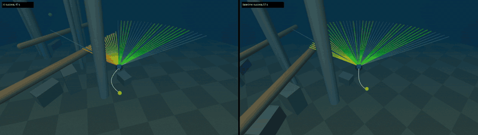
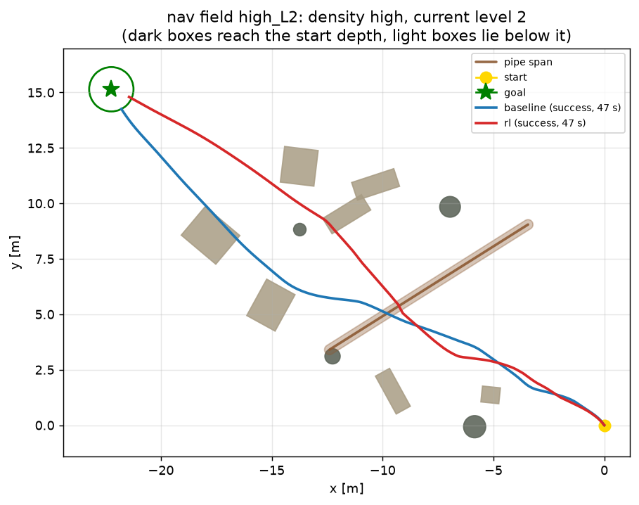
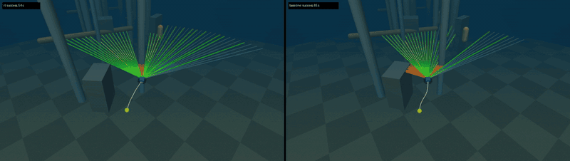
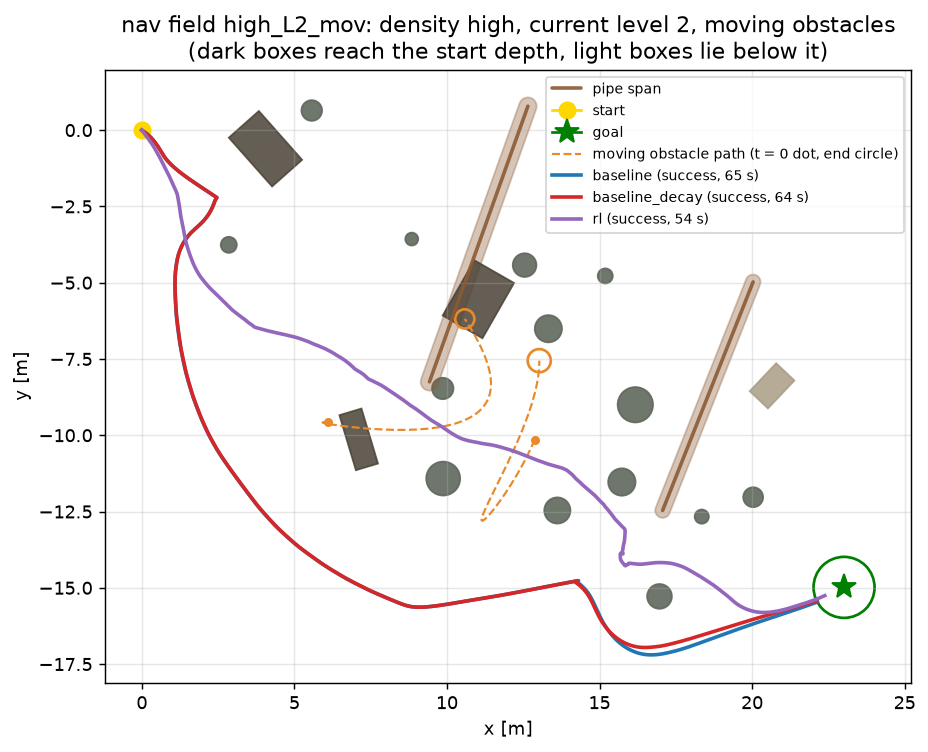

# Navigation tasks: sonar obstacle avoidance, nav and nav2 (details)

[Back to README](../README.md)

## Local planning / obstacle avoidance with sonar (nav task)

A second task, separate from station keeping and tracking: reach a goal 15-30 m away through a random
obstacle field, using only a simulated forward-looking sonar and the usual navigation sensors. An RL policy
(MJX + Brax PPO) is compared with a classical VFH+ planner. Both see the same sensor data, run on the same
episodes, and drive the same velocity controller.



*Left: RL. Right: VFH+. The sonar fan is coloured by range ([mp4](media/nav/nav_medium_L0_rl_vs_baseline.mp4)).
The GIF is sped up 2x.*

**Result: mixed.** The RL policy reaches the goal **13 % faster**, on a **more direct path** (1.05 vs 1.25 times the
straight-line distance) and with **15 % less thrust**. But it collides in 22 % of episodes, while the classical VFH+
planner collides in none and succeeds in 99 %. RL learned to cut corners and keeps too little margin (mean minimum
clearance 0.37 m vs 0.98 m), most of all in dense fields with current. See "Nav results" below.

### Scene

* **Layout:** start at the origin, facing the goal within +-0.6 rad. The goal bearing is random, its height
  within +-1 m. The seabed lies 2.5-4.5 m below the start, and the nominal surface is 30 m above it.
* **Obstacles** (`config.NavSceneConfig`) sit on a jittered 6 x 4 lattice inside a +-5 m corridor around the
  start-goal line. Each slot holds, with probability `slot_density`, one of:
  * a pillar or pile: a vertical capsule from below the seabed to the surface, radius 0.2-0.6 m;
  * a rock or wreck part: a yawed box resting on the seabed, 0.6-2.4 m wide and 0.6-5 m tall. Some reach the
    vehicle's depth, the others can be passed over.
* **Pipe spans:** up to two horizontal capsules cross the corridor near the vehicle's depth (radius
  0.2-0.4 m, 8-16 m long).
* **Feasibility:** the corridor is open at the sides, so a path around the field always exists. Obstacles
  closer than 1.5 m (surface distance, beyond the vehicle's bounding radius) to the start or the goal are
  removed; `tests/test_nav_scene.py` checks this.
* **Density levels** (slot occupancy / pipe probability): low 0.2 / 0.2, medium 0.4 / 0.45, high 0.6 / 0.7.
  Training samples densities from 0.1 to 0.65.
* **Current:** the existing current model. Training uses 0-0.25 m/s constant plus a 0-0.08 m/s sinusoid,
  with the plant randomisation of the control task and no thruster failures. Evaluation uses current levels
  0, 2 and 3 (0, 0.2 and 0.3 m/s); level 3 is outside the training range.
* **Collision:** the vehicle's bounding sphere (radius 0.416 m, half the diagonal of the published
  envelope) touches an obstacle or the seabed. This is conservative at the corners. Contacts stay disabled in
  the physics, and a collision ends the episode.

### Sensing (no privileged obstacle information)

* **Sonar fan:** 48 beams over 120 deg, 12 m maximum range, mounted 0.2 m ahead of the CoG. Each beam is cast
  at 5 elevations (-10 to +10 deg) and reports the nearest echo. Like an imaging sonar, it cannot tell at
  which elevation inside its 20 deg vertical aperture the echo came from.
* **Vertical beams:** an altimeter (down) and an up-looking beam.
* **Noise:** range noise with std 0.05 m + 1 % of the range. 3 % of returns drop out and read "no echo"
  (maximum range), which looks like free space.
* **Navigation sensors:** DVL body velocity (noise 0.02 m/s), gyro rates, gravity direction (roll and
  pitch), compass yaw, depth, and the goal vector in the body frame. The goal vector stands for an INS / USBL
  navigation solution and has no noise.
* **Observation:** 70 values (`nav_core.nav_observation`): the 48 normalised fan ranges, the 2 vertical
  ranges, the navigation sensors, and the previous command.
* **Rays are analytic, not MuJoCo sensors.** In mujoco-mjx 3.17 (`_src/ray.py`, read from the wheel), `ray`
  handles PLANE, SPHERE, CAPSULE, ELLIPSOID, BOX and MESH. It **silently skips CYLINDER**, and the MJX
  rangefinder sensor uses the same function. The scene therefore uses only capsules, boxes and the seabed
  plane. Rays and clearances are computed in closed form in `nav_core.py`, one backend-agnostic code path
  for the CPU and MJX envs. The obstacles never enter the physics model.
  * `tests/test_nav_geometry.py` checks the rays against analytic distances and against `mujoco.mj_ray` on a
    compiled scene model (up to 400 random rays per scene; agreement within 1e-6 m).
  * `tests/test_nav_mjx_parity.py` checks them against `mjx.ray`. It needs JAX, so it is skipped on the
    laptop.
  * **No matmul in `nav_core.py`.** On the RTX 5080, JAX's default float32 matmul precision may use TF32
    (~1e-3 relative error). Ray discriminants cancel badly, so `@` products turned grazing misses into hits
    and made the first ws1 parity run show MJX ranges up to 0.9 m short. All products are now elementwise;
    a test guards this, and `scripts/diag_nav_parity.py` compares CPU and JAX ray by ray on the GPU.

### Actions, reward, training

* **Action:** a normalised velocity command (surge +-0.6, sway +-0.3, heave +-0.3 m/s, yaw rate
  +-0.6 rad/s).
* **Velocity controller** (`nav_core.command_to_thrust`): it converts the command to the 8 thruster
  commands. It is the inner loop of the cascade PID (velocity P with drag and buoyancy feed-forward, yaw-rate
  P, roll / pitch PD, pseudo-inverse allocation) with the tuned gains from `config/pid_gains.json`.
  `tests/test_nav_baseline.py` checks that it is equivalent to `CascadePid.wrench`. RL and the baseline both
  use it, so the comparison is planner against planner.
* **Reward** (`config.NavRewardConfig`):
  * +2 per metre of progress towards the goal
  * +25 on success (within 1 m of the goal)
  * -50 on collision, tilt beyond 60 deg, or a non-finite state
  * -0.05 x (1 - clearance / 1 m)^2 when closer than 1 m to an obstacle
  * small effort, command-rate, time and tilt penalties
* **Episodes** end on success, collision or failure, or time out after 100 s (2500 control steps at
  25 Hz).
* **PPO** (`python train.py --task nav`): the same networks and hyper-parameters as the control task,
  except gamma = 0.995 (an 8 s horizon). The full preset is 300 M steps.
* **No memory:** the policy is a memoryless MLP. It sees only the current scan, so an obstacle that has left
  the 120 deg fan is forgotten. No frame stack or recurrent policy is used. If the evaluation shows
  collisions caused by side or near-field blind spots, a short frame stack of the fan is the first thing to
  add.

### Classical baseline: VFH+ over a sonar occupancy grid (`rov_rl/nav_baseline.py`)

* **Same inputs:** the planner reads only the `NavMeasurement` the observation is built from.
* **Pose:** its pose in a goal-centred frame is -R(roll, pitch, yaw) x goal_body, the same navigation
  solution the policy gets.
* **Occupancy grid:** a 0.25 m log-odds grid. Echoes are placed in the horizontal plane. Echoes at the range
  where the lowest elevation row meets the seabed (from the altimeter) are rejected as seabed.
* **VFH+** (Ulrich & Borenstein 1998): an enlarged polar histogram inside a window, hysteresis thresholds,
  candidate directions at valley borders, centres and the goal direction, and a cost on goal, heading and
  previous-choice deviation.
* **Command:** turn to the chosen direction, surge when aligned, slow down by the nearest forward echo, back
  off inside the stop range. Depth is held on the goal height with an altimeter floor and an up-beam ceiling.
* **Memory:** the grid remembers obstacles outside the fan; the MLP policy has no such memory.
* **Tuning:** `scripts/tune_nav_baseline.py` runs a coordinate search on 24 tuning episodes (seed 7, current
  levels 1 and 3, all densities). These are disjoint from the evaluation episodes (seed 2024). The result
  and its provenance note are in `config/nav_baseline.json`.

### Metrics (`eval_nav.py`, `rov_rl/nav_rollout.py`)

* **Cells:** density (low / medium / high) x current level (0 / 2 / 3), 20 episodes per cell by default.
  RL and VFH+ see identical fields, currents and sensor-noise sequences.
* **Rates:** success, collision and timeout (incl. tilt failure) over all episodes.
* **Means over successful episodes:**
  * time to goal
  * path ratio: path length / straight start-goal distance. The 1 m goal radius lets a direct run come in
    slightly below 1.
  * thrust impulse (the energy proxy)
* **Min clearance:** the true gap between the bounding sphere and the nearest obstacle or the seabed, as
  mean and worst over all episodes.
* **Outputs:** `runs/<stage>/nav_eval/metrics.json` and `results.md` (rewritten after every cell), plus
  `videos/`:
  * chase camera, murky look, sonar fan coloured by range (red near, yellow, green far; faint cyan = no
    echo), travelled path, goal and current arrow
  * one clip per controller and `*_rl_vs_baseline.mp4` side by side
* **Overhead plot:** `paths_<cell>.png` shows one field with both paths.

### Running

```bash
# laptop / CPU: tests (MJX parity skipped), baseline-only evaluation, baseline tuning
PYTEST_DISABLE_PLUGIN_AUTOLOAD=1 python -m pytest -q
python eval_nav.py --controllers baseline --episodes 2 --out-dir outputs/nav_baseline --no-video
python scripts/tune_nav_baseline.py --out config/nav_baseline.json
# GPU workstation
MJRL_VENV=~/.venvs/mjrl scripts/run_ws1.sh nav_smoke   # tests, 2 M-step training, short eval + video + plot
MJRL_VENV=~/.venvs/mjrl scripts/run_ws1.sh nav_full    # 300 M-step training, full evaluation
tail -f runs/nav_full/train.log runs/nav_full/nav_eval.log
```

### Nav results

Measured on workstation1 (RTX 5080), 2026-11-06, with `scripts/run_ws1.sh nav_full`:
- **Training:** PPO, 300 M env steps (about 9 min of training).
- **Evaluation:** CPU env, 20 episodes per cell, the same seeds for both controllers (eval seed 2024; the baseline
  was tuned on seed 7).
- **Physics parity:** the MJX/CPU parity tests (`tests/test_nav_mjx_parity.py`) pass on the GPU.
  - Ray geometry agrees to 0.2 mm after the elementwise rewrite.
  - In the open-loop part of the test, a single beam may flip at an obstacle silhouette because of float32
    state drift. The test checks that the CPU ray code re-cast at the MJX pose explains that beam.

| density | current (const/amp m/s) | controller | success | collision | timeout | time to goal [s] | path ratio | min clearance mean / worst [m] | thrust impulse [N s] |
|---|---|---|---|---|---|---|---|---|---|
| low | 0 (0.00/0.00) | baseline | 1.00 | 0.00 | 0.00 | 44.2 | 1.11 | 1.18 / 0.54 | 5449 |
| low | 0 (0.00/0.00) | rl | 0.90 | 0.10 | 0.00 | 39.8 | 1.01 | 0.68 / -0.02 | 4760 |
| low | 2 (0.20/0.06) | baseline | 1.00 | 0.00 | 0.00 | 45.6 | 1.09 | 1.17 / 0.42 | 6304 |
| low | 2 (0.20/0.06) | rl | 0.90 | 0.10 | 0.00 | 42.8 | 1.01 | 0.77 / -0.02 | 5783 |
| low | 3 (0.30/0.09) | baseline | 1.00 | 0.00 | 0.00 | 48.5 | 1.10 | 1.10 / 0.38 | 6737 |
| low | 3 (0.30/0.09) | rl | 0.85 | 0.15 | 0.00 | 49.9 | 1.01 | 0.68 / -0.01 | 6721 |
| medium | 0 (0.00/0.00) | baseline | 1.00 | 0.00 | 0.00 | 44.9 | 1.21 | 1.09 / 0.47 | 5535 |
| medium | 0 (0.00/0.00) | rl | 0.95 | 0.05 | 0.00 | 38.6 | 1.03 | 0.35 / -0.00 | 4548 |
| medium | 2 (0.20/0.06) | baseline | 1.00 | 0.00 | 0.00 | 48.0 | 1.34 | 1.10 / 0.33 | 6094 |
| medium | 2 (0.20/0.06) | rl | 0.80 | 0.20 | 0.00 | 40.5 | 1.07 | 0.22 / -0.01 | 5113 |
| medium | 3 (0.30/0.09) | baseline | 0.95 | 0.00 | 0.05 | 57.3 | 1.35 | 0.75 / 0.24 | 7785 |
| medium | 3 (0.30/0.09) | rl | 0.65 | 0.35 | 0.00 | 44.8 | 1.09 | 0.25 / -0.02 | 5929 |
| high | 0 (0.00/0.00) | baseline | 1.00 | 0.00 | 0.00 | 53.6 | 1.34 | 0.90 / 0.42 | 6507 |
| high | 0 (0.00/0.00) | rl | 0.75 | 0.25 | 0.00 | 43.0 | 1.07 | 0.11 / -0.01 | 4956 |
| high | 2 (0.20/0.06) | baseline | 1.00 | 0.00 | 0.00 | 56.0 | 1.35 | 0.75 / 0.39 | 7188 |
| high | 2 (0.20/0.06) | rl | 0.45 | 0.55 | 0.00 | 46.8 | 1.08 | 0.08 / -0.01 | 5990 |
| high | 3 (0.30/0.09) | baseline | 0.95 | 0.00 | 0.05 | 58.6 | 1.35 | 0.75 / 0.31 | 8240 |
| high | 3 (0.30/0.09) | rl | 0.80 | 0.20 | 0.00 | 52.5 | 1.11 | 0.19 / -0.01 | 7152 |
| all | all | baseline | 0.99 | 0.00 | 0.01 | 50.7 | 1.25 | 0.98 / 0.24 | 6633 |
| all | all | rl | 0.78 | 0.22 | 0.00 | 44.0 | 1.05 | 0.37 / -0.02 | 5617 |

success / collision / timeout: fractions of all episodes (timeout includes tilt failures). Time to goal, path ratio (path length / straight start-goal distance) and thrust impulse: mean over successful episodes. Min clearance: true gap between the vehicle bounding sphere and the nearest obstacle or the seabed, per episode; mean and worst over all episodes.



**What would likely fix the RL collisions:**
- give the policy memory, with fan frame stacking or a recurrent policy, so it remembers obstacles that have left
  the 120 deg fan;
- a stronger clearance penalty, or a safety filter;
- curriculum training on dense fields.

None of these has been run yet.

### Nav-task limitations

* **Ideal sonar:** each beam is a thin ray. There is no beam width, no multipath, no acoustic shadowing
  model, no blanking distance and no scan-rate latency (a full fan every 40 ms).
* **Ideal navigation:** the goal vector (INS / USBL solution) and the attitude are noise-free. Only the sonar
  ranges and the DVL are noisy.
* **Ideal inner loop:** the low-level velocity controller uses the true velocity, as the control-task PID
  does.
* **Conservative collision:** the bounding sphere flags some near misses as collisions; there is no contact
  dynamics.
* **Simplified scene:** pipe spans float without supports, and obstacles may overlap one another (rock
  piles); only the start and goal keep-out is enforced.

## nav2: fan memory, safety shaping, moving obstacles, curriculum

The first nav policy was faster and more direct than VFH+, but it collided in 22 % of episodes, against 0 %
for VFH+. The mean minimum clearance was 0.37 m against 0.98 m. Most collisions came in dense fields with
current. nav2 tries to close that gap while keeping most of the speed. It also adds moving obstacles.
`train.py --task nav2` / `eval_nav.py --task nav2`; the nav task, its presets and its results are unchanged.

### Changes

* **Short-term obstacle memory** (`config.MemoryConfig`, `nav_core.memory_update` / `memory_polar`).
  * **How it works:** every 0.4 s, the fan's echo points within 6 m are stored in a 12-slot ring buffer as
    horizontal offsets from the vehicle. Every step the stored points are moved by the measured displacement:
    DVL velocity rotated by the measured attitude and compass. Points expire after 4.8 s.
  * **What the policy sees:** 24 extra observation values, the nearest remembered point per 15 deg sector over
    the full 360 deg around the current heading (94 values in total).
  * **Why not a frame stack:** stacking the last K = 4 fans covers only 0.16 s and nothing outside the 120 deg
    fan. The collisions happen next to and behind the vehicle while it rounds an obstacle, and that is what the
    memory covers.
  * **No privileged information:** only measured quantities are used, and no obstacle velocities.
  * **Parity:** the update is elementwise like the rest of `nav_core`, so CPU and MJX produce the same
    observation.
* **Safety shaping** (`NAV2_CONFIG.reward`):
  * a barrier -0.2 x (1 - clearance / 0.8 m)^2. At 0.4 m it costs more per step than cruising earns in
    progress.
  * a proximity speed penalty -0.05 x (1 - clearance / 0.8 m) x speed / 0.6 m/s.
  * Collision termination and the -50 penalty are unchanged.
* **Moving obstacles** (`NavSceneConfig.num_movers` = 3 slots, `mover_prob`).
  * **Shape and motion:** vertical capsules (r 0.3-0.6 m, 0.6-1.2 m tall) near the vehicle's depth. They
    either patrol smooth 2D Lissajous loops (amplitude 1-4 m, per-axis peak speed 0.1-0.3 m/s, at most about
    0.42 m/s combined) or, with probability 0.25, drift with the water current (closed-form integral of the
    current model).
  * **Same code path:** rays, clearance and collision use the obstacle poses at the current time through
    `nav_core.scene_at`, in both envs.
  * **Keep-out:** patrol loops keep clear of the start and goal at all times. Drifters are checked only at
    t = 0.
  * **No interaction:** movers may pass through static obstacles.
  * **Seeds:** static fields keep their seeds, because mover uniforms are drawn after the static ones.
* **Curriculum** (`config.NAV2_CURRICULUM`): three stages run inside one `train.py` call. Each stage is a
  `ppo.train` call that continues from the previous stage's normaliser, policy and value parameters (brax
  `restore_params`); the optimiser state restarts.
  * 20 %: sparse fields (occupancy 0.05-0.3), current up to 0.08 m/s, no movers.
  * 30 %: occupancy up to 0.5, current up to 0.2 m/s, movers active with probability 0.3.
  * 50 %: occupancy up to 0.7, current up to 0.32 m/s (covers eval level 3), movers with probability 0.6.
  * The env's `reset()` cannot see the global step count, because the playground auto-reset wrapper re-creates
    the info dict. That is why the curriculum is staged rather than scheduled inside the env.
* **Training:** PPO as for nav (gamma 0.995), 600 M steps in the full preset.
* **Baselines:**
  * `baseline` is the unchanged VFH+ (`config/nav_baseline.json`), so static cells compare directly with the
    nav results.
  * `baseline_decay` adds one option: all grid log-odds relax towards "unknown" with rate
    `logodds_decay_per_s`, so cells vacated by a moving obstacle are freed. The rate was chosen by
    `scripts/tune_nav_baseline.py --decay-only` on the tuning seed (static and moving tuning episodes), with
    all other parameters unchanged (`config/nav_baseline_decay.json`).
* **Evaluation:** `eval_nav.py --movers static,moving`.
  * Static cells keep their names and seeds.
  * Moving cells (`*_mov`, 3 mover slots active with probability 0.8) use an extra seed component.
  * All controllers run the same episodes.
  * Videos draw the movers as orange capsules with trails; the overhead plot draws their dashed paths.

### nav2 results



*Left: nav2 RL. Right: VFH+. Dense field, 0.2 m/s current, moving obstacles; GIF at 2x
([mp4](media/nav2/nav2_high_L2_mov_rl_vs_vfh.mp4)).*

Measured on workstation1 (RTX 5080), 2026-11-06:
- **Training:** 600 M env steps in a 3-stage curriculum, about 55 min.
- **Evaluation:** CPU, 18 cells (9 static + 9 with moving obstacles) x 20 episodes. RL, `baseline` and `baseline_decay`
  all ran the same seeded episodes.
- **Physics parity:** the nav and nav2 MJX/CPU parity tests (123 tests in total) passed on the GPU before training.

| all cells | nav (v1) RL | **nav2 RL** | VFH+ | VFH+ (decaying grid) |
|---|---|---|---|---|
| success | 0.78 | **0.97** | 0.99 | 0.99 |
| collision | 0.22 | **0.03** | 0.00 | 0.00 |
| time to goal [s] | 44.0 | **41.8** | 50.7 | 50.2 |
| path ratio | 1.05 | **1.06** | 1.27 | 1.26 |
| thrust impulse [N s] | 5617 | **5134** | 6539 | 6488 |

*The v1 column is the static-only nav evaluation (9 cells); the other columns cover all 18 nav2 cells.*

Memory, safety shaping and the curriculum cut RL collisions from 22 % to 3 %. nav2 RL is about 18 % faster than VFH+,
takes paths about 17 % shorter and uses about 21 % less thrust, but it still collides slightly more often (3 % vs 0 %).

<details><summary>Full per-cell table</summary>

| density | current (const/amp m/s) | controller | success | collision | timeout | time to goal [s] | path ratio | min clearance mean / worst [m] | thrust impulse [N s] |
|---|---|---|---|---|---|---|---|---|---|
| low | 0 (0.00/0.00) | baseline | 1.00 | 0.00 | 0.00 | 44.2 | 1.11 | 1.18 / 0.54 | 5449 |
| low | 0 (0.00/0.00) | baseline_decay | 1.00 | 0.00 | 0.00 | 44.2 | 1.11 | 1.16 / 0.34 | 5446 |
| low | 0 (0.00/0.00) | rl | 0.95 | 0.05 | 0.00 | 38.1 | 1.01 | 1.02 / -0.01 | 4513 |
| low | 2 (0.20/0.06) | baseline | 1.00 | 0.00 | 0.00 | 45.6 | 1.09 | 1.17 / 0.42 | 6304 |
| low | 2 (0.20/0.06) | baseline_decay | 1.00 | 0.00 | 0.00 | 45.6 | 1.09 | 1.14 / 0.40 | 6296 |
| low | 2 (0.20/0.06) | rl | 1.00 | 0.00 | 0.00 | 41.0 | 1.01 | 0.90 / 0.36 | 5467 |
| low | 3 (0.30/0.09) | baseline | 1.00 | 0.00 | 0.00 | 48.5 | 1.10 | 1.10 / 0.38 | 6737 |
| low | 3 (0.30/0.09) | baseline_decay | 1.00 | 0.00 | 0.00 | 48.3 | 1.09 | 1.05 / 0.37 | 6706 |
| low | 3 (0.30/0.09) | rl | 1.00 | 0.00 | 0.00 | 45.7 | 1.02 | 0.86 / 0.00 | 5976 |
| medium | 0 (0.00/0.00) | baseline | 1.00 | 0.00 | 0.00 | 44.9 | 1.21 | 1.09 / 0.47 | 5535 |
| medium | 0 (0.00/0.00) | baseline_decay | 1.00 | 0.00 | 0.00 | 44.9 | 1.21 | 1.07 / 0.47 | 5534 |
| medium | 0 (0.00/0.00) | rl | 1.00 | 0.00 | 0.00 | 37.4 | 1.04 | 0.60 / 0.10 | 4363 |
| medium | 2 (0.20/0.06) | baseline | 1.00 | 0.00 | 0.00 | 48.0 | 1.34 | 1.10 / 0.33 | 6094 |
| medium | 2 (0.20/0.06) | baseline_decay | 1.00 | 0.00 | 0.00 | 47.6 | 1.33 | 1.09 / 0.15 | 6034 |
| medium | 2 (0.20/0.06) | rl | 1.00 | 0.00 | 0.00 | 37.7 | 1.08 | 0.62 / 0.09 | 4515 |
| medium | 3 (0.30/0.09) | baseline | 0.95 | 0.00 | 0.05 | 57.3 | 1.35 | 0.75 / 0.24 | 7785 |
| medium | 3 (0.30/0.09) | baseline_decay | 0.90 | 0.00 | 0.10 | 55.4 | 1.35 | 0.77 / 0.30 | 7451 |
| medium | 3 (0.30/0.09) | rl | 1.00 | 0.00 | 0.00 | 46.9 | 1.07 | 0.60 / 0.19 | 6268 |
| high | 0 (0.00/0.00) | baseline | 1.00 | 0.00 | 0.00 | 53.6 | 1.34 | 0.90 / 0.42 | 6507 |
| high | 0 (0.00/0.00) | baseline_decay | 1.00 | 0.00 | 0.00 | 53.6 | 1.33 | 0.92 / 0.41 | 6495 |
| high | 0 (0.00/0.00) | rl | 0.95 | 0.05 | 0.00 | 41.6 | 1.08 | 0.36 / -0.00 | 4794 |
| high | 2 (0.20/0.06) | baseline | 1.00 | 0.00 | 0.00 | 56.0 | 1.35 | 0.75 / 0.39 | 7188 |
| high | 2 (0.20/0.06) | baseline_decay | 1.00 | 0.00 | 0.00 | 55.6 | 1.34 | 0.77 / 0.39 | 7132 |
| high | 2 (0.20/0.06) | rl | 0.95 | 0.05 | 0.00 | 44.1 | 1.06 | 0.49 / -0.00 | 5284 |
| high | 3 (0.30/0.09) | baseline | 0.95 | 0.00 | 0.05 | 58.6 | 1.35 | 0.75 / 0.31 | 8240 |
| high | 3 (0.30/0.09) | baseline_decay | 1.00 | 0.00 | 0.00 | 60.2 | 1.36 | 0.78 / 0.31 | 8480 |
| high | 3 (0.30/0.09) | rl | 0.95 | 0.05 | 0.00 | 49.4 | 1.08 | 0.41 / -0.01 | 6579 |
| low (moving) | 0 (0.00/0.00) | baseline | 1.00 | 0.00 | 0.00 | 43.1 | 1.16 | 1.01 / 0.15 | 5278 |
| low (moving) | 0 (0.00/0.00) | baseline_decay | 1.00 | 0.00 | 0.00 | 42.3 | 1.15 | 1.05 / 0.30 | 5187 |
| low (moving) | 0 (0.00/0.00) | rl | 1.00 | 0.00 | 0.00 | 35.6 | 1.01 | 0.78 / 0.08 | 4240 |
| low (moving) | 2 (0.20/0.06) | baseline | 1.00 | 0.00 | 0.00 | 45.0 | 1.07 | 0.99 / 0.25 | 6029 |
| low (moving) | 2 (0.20/0.06) | baseline_decay | 1.00 | 0.00 | 0.00 | 44.7 | 1.06 | 0.99 / 0.28 | 5995 |
| low (moving) | 2 (0.20/0.06) | rl | 1.00 | 0.00 | 0.00 | 41.9 | 1.02 | 0.78 / 0.20 | 5372 |
| low (moving) | 3 (0.30/0.09) | baseline | 0.95 | 0.00 | 0.05 | 45.6 | 1.14 | 0.98 / 0.30 | 6140 |
| low (moving) | 3 (0.30/0.09) | baseline_decay | 0.95 | 0.00 | 0.05 | 45.8 | 1.15 | 0.95 / 0.27 | 6162 |
| low (moving) | 3 (0.30/0.09) | rl | 0.95 | 0.05 | 0.00 | 42.1 | 1.06 | 0.68 / -0.01 | 5427 |
| medium (moving) | 0 (0.00/0.00) | baseline | 1.00 | 0.00 | 0.00 | 52.2 | 1.34 | 0.85 / 0.24 | 6381 |
| medium (moving) | 0 (0.00/0.00) | baseline_decay | 1.00 | 0.00 | 0.00 | 51.2 | 1.33 | 0.86 / 0.27 | 6260 |
| medium (moving) | 0 (0.00/0.00) | rl | 1.00 | 0.00 | 0.00 | 39.2 | 1.06 | 0.40 / 0.05 | 4552 |
| medium (moving) | 2 (0.20/0.06) | baseline | 1.00 | 0.00 | 0.00 | 52.8 | 1.41 | 0.81 / 0.30 | 6827 |
| medium (moving) | 2 (0.20/0.06) | baseline_decay | 1.00 | 0.00 | 0.00 | 52.3 | 1.40 | 0.81 / 0.30 | 6731 |
| medium (moving) | 2 (0.20/0.06) | rl | 0.95 | 0.05 | 0.00 | 39.8 | 1.06 | 0.49 / -0.02 | 4712 |
| medium (moving) | 3 (0.30/0.09) | baseline | 1.00 | 0.00 | 0.00 | 51.9 | 1.27 | 0.71 / 0.20 | 6731 |
| medium (moving) | 3 (0.30/0.09) | baseline_decay | 1.00 | 0.00 | 0.00 | 51.7 | 1.27 | 0.71 / 0.19 | 6729 |
| medium (moving) | 3 (0.30/0.09) | rl | 1.00 | 0.00 | 0.00 | 43.3 | 1.08 | 0.49 / 0.01 | 5153 |
| high (moving) | 0 (0.00/0.00) | baseline | 1.00 | 0.00 | 0.00 | 51.9 | 1.38 | 0.85 / 0.28 | 6270 |
| high (moving) | 0 (0.00/0.00) | baseline_decay | 1.00 | 0.00 | 0.00 | 50.5 | 1.36 | 0.83 / 0.28 | 6145 |
| high (moving) | 0 (0.00/0.00) | rl | 0.95 | 0.05 | 0.00 | 39.1 | 1.09 | 0.43 / -0.00 | 4350 |
| high (moving) | 2 (0.20/0.06) | baseline | 1.00 | 0.00 | 0.00 | 53.7 | 1.36 | 0.79 / 0.21 | 6835 |
| high (moving) | 2 (0.20/0.06) | baseline_decay | 1.00 | 0.00 | 0.00 | 53.6 | 1.36 | 0.81 / 0.22 | 6811 |
| high (moving) | 2 (0.20/0.06) | rl | 1.00 | 0.00 | 0.00 | 43.2 | 1.11 | 0.43 / 0.03 | 5057 |
| high (moving) | 3 (0.30/0.09) | baseline | 1.00 | 0.00 | 0.00 | 59.7 | 1.44 | 0.85 / 0.16 | 7506 |
| high (moving) | 3 (0.30/0.09) | baseline_decay | 0.95 | 0.00 | 0.05 | 57.7 | 1.39 | 0.79 / 0.12 | 7306 |
| high (moving) | 3 (0.30/0.09) | rl | 0.75 | 0.25 | 0.00 | 48.0 | 1.12 | 0.25 / -0.01 | 5986 |
| all | all | baseline | 0.99 | 0.00 | 0.01 | 50.7 | 1.27 | 0.92 / 0.15 | 6539 |
| all | all | baseline_decay | 0.99 | 0.00 | 0.01 | 50.2 | 1.26 | 0.92 / 0.12 | 6488 |
| all | all | rl | 0.97 | 0.03 | 0.00 | 41.8 | 1.06 | 0.59 / -0.02 | 5134 |

success / collision / timeout: fractions of all episodes (timeout includes tilt failures). Time to goal, path ratio (path length / straight start-goal distance) and thrust impulse: mean over successful episodes. Min clearance: true gap between the vehicle bounding sphere and the nearest obstacle or the seabed, per episode; mean and worst over all episodes.

</details>


